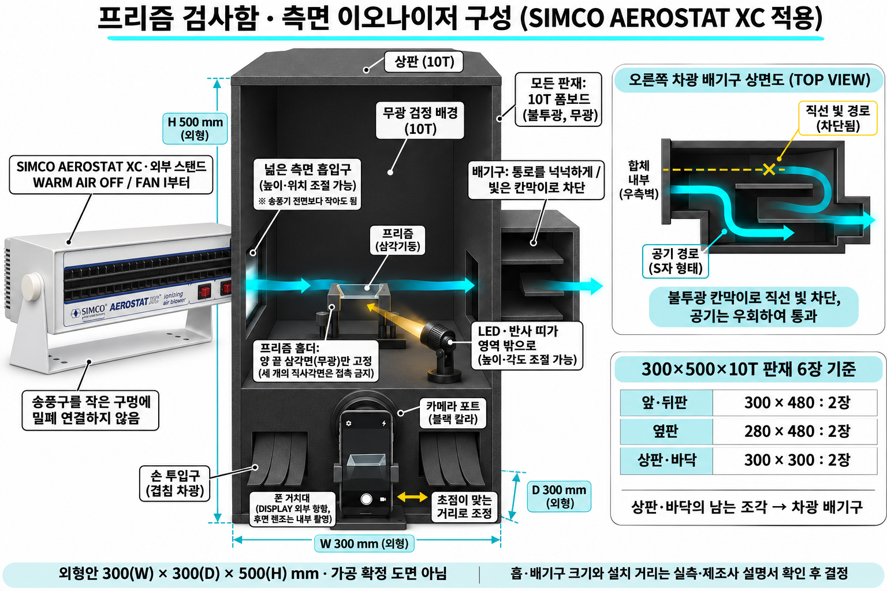
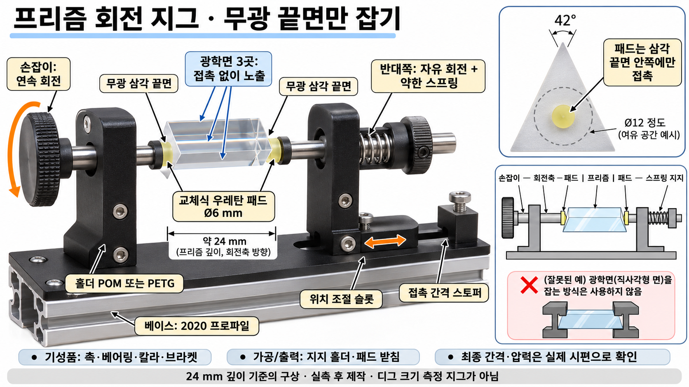

# 폼보드 검사함과 수동 회전 지그

구상이며 제작 확정 도면이나 성능 인증이 아니다. 프리즘 치수·이오나이저 설치 거리·실제 폰의 초점과 작업 자세를 확인한 뒤 개구부와 고정 치수를 정한다.

## 검사함

양손을 넣고 반복 관찰하는 공간을 고려해 외형 **300(W)×300(D)×500(H)mm**, 10T 판재를 기준으로 잡는다. 300×500×10T 판재 **6장**을 쓰는 재단 구성이다.

| 부품 | 크기 mm | 수량 |
|---|---|---:|
| 앞·뒤판 | 300×480 | 2 |
| 옆판 | 280×480 | 2 |
| 상판·바닥 | 300×300 | 2 |

옆판은 앞·뒤판 사이에, 네 벽은 상판·바닥 사이에 들어간다. 실제 판 두께·직각도·절단 여유를 확인한다. 상판·바닥을 자르고 남는 조각으로 차광 배기구와 보강재를 만든다. 모든 칸막이를 10T로 만들어도 되므로 5T를 따로 살 필요는 없다. 앞서 제시한 낮은 상자는 재료 배치 예시이며 반복 손 작업에는 이 높은 구상을 사용한다.

절단면은 가루가 떨어지지 않게 마감한다. 바닥은 먼지를 닦기 쉬운 매끈한 재질로 하고, 검정 저반사 시트는 광학면과 닿지 않게 배경·벽에 사용한다. 폰·조명·이오나이저 무게는 별도 거치대로 지지한다.

## 실제 이오나이저

그림은 내부를 보이기 위해 앞판 일부를 생략한 단면 구상이다. **실제 앞판은 불투명하게 막고 렌즈·손 투입구만 남긴다.** 배기구 그림도 흐름과 차광 원리를 설명하는 것이며, 판재 재단용 CAD가 아니다.

사용자 사진의 명판은 **SIMCO AEROSTAT XC**다. 가로로 긴 송풍형 장치이며 FAN SPEED, WARM AIR 스위치가 있다. 뒷면 명판의 히터 표기는 **350W**다.

기기는 기존 스탠드로 검사함 밖에 두고 통풍구를 막지 않는다. 긴 송풍구를 작은 구멍으로 밀폐·축소 연결하는 구상은 사용하지 않는다. 측면의 넓은 입구로 바람 일부가 검사 위치에 들어오도록 맞추고, 반대편에는 충분한 통과 면적의 차광 배기구를 둔다. 칸막이를 엇갈리게 놓아 빛의 직선 유입을 막는다. 우선 별도 배기 팬 없이 흐름을 확인한다.

검사함에서는 **WARM AIR OFF, FAN I부터** 사용한다. 바람에 시편이 흔들리면 풍량·배치를 조정한다. 이오나이저는 정전기 저감 장치이며, 이 배치만으로 미세먼지 제거·청정도·양압 성능을 보증하지 않는다. 필터를 추가하거나 출구를 덕트에 연결하는 방법과 설치 거리는 제조사 설명서를 확인한다. 현재 사진만으로 정확한 거리·풍량·개구부 크기를 확정하지 않는다.

## 시편 지그의 접촉 위치

검사 대상은 광학면 세 곳 전체다. 양끝의 **무광 삼각 끝면** 중심부만 작은 평활 패드로 잡는다. 긴 직사각 광학면을 V홈·악어집게·바이스 모서리로 물리지 않는다.

기본 구조는 한쪽 손잡이 회전축과 반대쪽 자유 회전·스프링 지지다. 회전축 방향의 프리즘 깊이 약 24mm를 기준으로 홀더 사이를 조절한다. 패드 예시는 지름 약 6mm, 우레탄 두께 0.5~1mm이며 최종 치수·탄성·조임 힘은 실물로 확인한다. 스토퍼로 과도한 조임을 제한하고, 불량 샘플로 자국과 회전 안정성을 먼저 확인한다. 광학면 아래에는 회전 중 닿을 받침을 두지 않는다.

## 쿠팡·다이소 부품으로 만드는 시제품

아래는 **검색 대상과 선택 조건**이다. 현재 환경의 네트워크 허용 목록 제한 때문에 실제 상품 페이지·가격·재고·최소 간격을 확인하지 못했다. 구매 확정 목록이 아니다.

| 부품 | 찾을 이름 | 구매 전에 확인할 조건 |
|---|---|---|
| 프리즘 회전 틀 | `360도 PCB 기판 홀더`, `스프링 기판 홀더` | 양끝이 같은 축으로 회전하고 패드 간격을 24mm 부근까지 좁힐 수 있어야 함 |
| 끝면 접촉부 | `평활 우레탄 시트 1mm`, `실리콘 평판 패드` | 비점착 접촉면, 패드가 무광 삼각 끝면 안에만 닿도록 교체 가능 |
| 폰 고정 | `탁상 관절 스마트폰 거치대` | 폰·케이스 폭, 각도 잠금, 짧고 단단한 암, 작업대에 독립 고정 |
| 배경·차광 | 다이소의 검정 판재·시트·테이프류 | 광택·털 빠짐·가루가 적은 것을 실물 확인 |

일반 PCB 홀더의 V홈은 PCB 모서리를 잡도록 되어 있어, 그대로 프리즘을 끼워도 된다고 가정하지 않는다. 매끈한 평판 접촉 어댑터와 작은 패드로 바꿀 수 있는 모델을 우선 검토한다. 최소 간격이 큰 모델은 시편을 잡지 못할 수 있다. 회전시키면서 모서리가 베이스·브라켓에 닿지 않을 여유도 확인한다. 이 조건이 맞지 않으면 가공한 POM 홀더 또는 PETG 출력 홀더를 사용한다.

산업용 기성품 후보는 [한국미스미](https://kr.misumi-ec.com/), [디바이스마트](https://www.devicemart.co.kr/), [엘레파츠](https://www.eleparts.co.kr/)에서 `2020 프로파일`, `6mm 샤프트`, `내경 6mm 베어링`, `6mm 샤프트 칼라`로 찾을 수 있다. 개별 판매 품번·재고는 확인하지 않았다.
